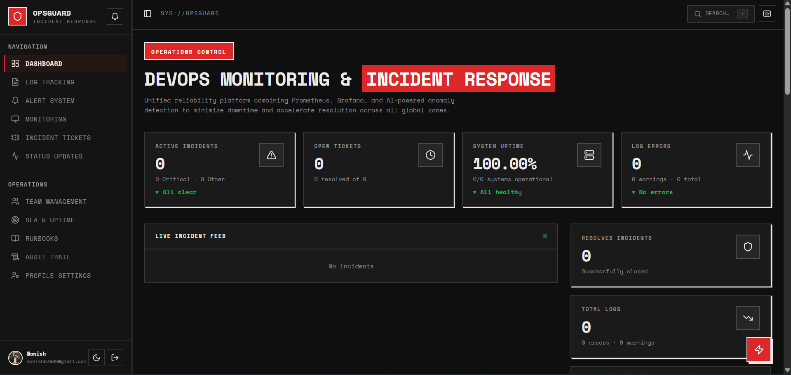
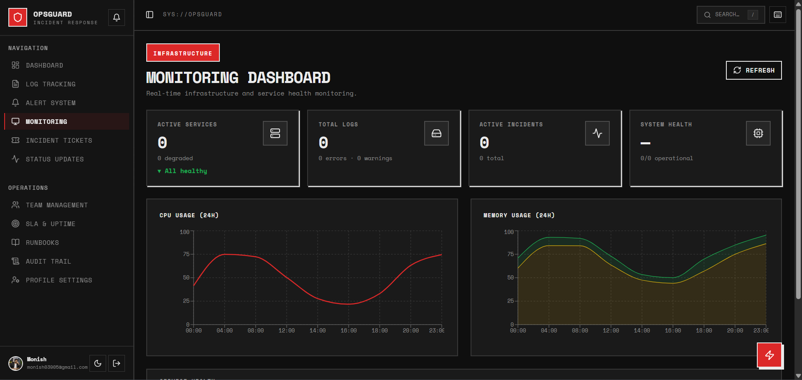
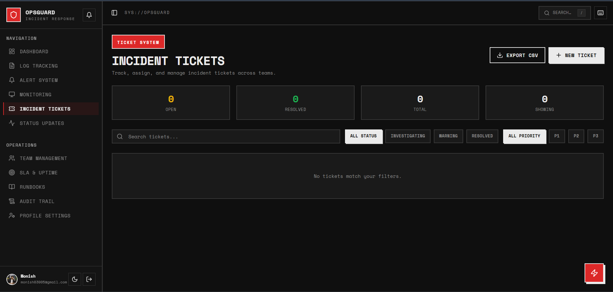
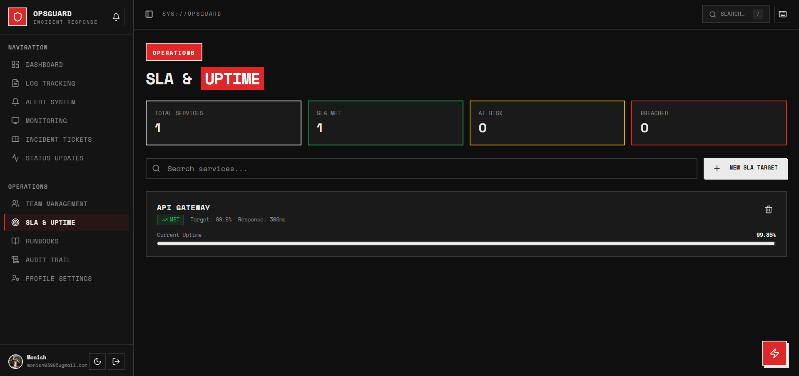

# OpsGuard

### Real-Time Incident Response & Operations Control Platform

> **Observe. Respond. Resolve.**

OpsGuard brings service monitoring, incident and ticket management, SLA tracking, on-call teams, runbooks and an audit trail into one operations console. It is a full-stack React application backed by Supabase (Postgres + Auth + row-level security), with a test suite, a security check, CI workflows and a Vercel deployment.

[](https://opsguard-j7ygzrnec-monish3905.vercel.app/)
[](#stack)
[](#stack)
[](#stack)
[](#stack)
[](#scripts)

---

## Screens

| Dashboard | Monitoring |
| --- | --- |
|  |  |

| Incidents & tickets | SLA tracking |
| --- | --- |
|  |  |

---

## What it does

- **Operations dashboard** — service health, operational metrics, live incident feed, SLA compliance, on-call rotation and recent activity in one view.
- **Monitoring** — service and resource status with CPU/memory visualization and an uptime chart.
- **Incidents & tickets** — create, classify by priority, investigate, track and close; search, filter and export to CSV.
- **SLA tracking** — targets, compliance widgets and historical uptime.
- **Status updates** — a running feed of service status communications.
- **Teams & on-call** — team membership and current responders.
- **Runbooks** — step-by-step operational procedures attached to response work.
- **Audit trail** — an append-only record of operational actions.
- **Alerts, logs and global search** — a notification dropdown, log tracking, and a `Ctrl/⌘+K` command palette plus keyboard shortcuts.
- **Accounts and roles** — Supabase auth, protected routes, profile settings, and role checks enforced in the database.

## Stack

| Layer | Choice |
| --- | --- |
| Front end | React 18 + TypeScript + Vite 5 |
| UI | Tailwind CSS, shadcn/ui (Radix), framer-motion, Recharts, lucide |
| Auth & data | Supabase (Postgres, Auth, RLS) |
| Routing & state | React Router 6, TanStack Query, React Hook Form + Zod |
| Tests | Vitest + Testing Library |
| CI/CD | GitHub Actions (`ci.yml`, `security.yml`) |
| Hosting | Vercel (`vercel.json`) |

## Quick start

### 1. Install

```bash
npm install
```

### 2. Configure Supabase

```bash
cp .env.example .env
```

```env
VITE_SUPABASE_URL=https://your-project.supabase.co
VITE_SUPABASE_PUBLISHABLE_KEY=your-anon-key
```

### 3. Apply the schema

The migrations in `supabase/migrations/` create the tables, RLS policies and role helpers:

```bash
supabase link --project-ref <your-project-ref>
supabase db push
```

Or run the SQL files in order in the Supabase SQL editor.

### 4. Run

```bash
npm run dev      # Vite dev server
```

## Scripts

| Command | What it does |
| --- | --- |
| `npm run dev` | Start the dev server |
| `npm run build` | Production build |
| `npm run preview` | Serve the build locally |
| `npm test` | Vitest test suite |
| `npm run test:watch` | Vitest in watch mode |
| `npm run lint` | ESLint |
| `npm run security` | Custom security checks (`scripts/security-check.mjs`) |

## Routes

| Route | Page |
| --- | --- |
| `/` | Operations control dashboard |
| `/monitoring` | Service & resource monitoring |
| `/tickets` | Incidents and tickets |
| `/sla` | SLA tracking |
| `/teams` | Team management / on-call |
| `/runbooks` | Operational runbooks |
| `/alerts` | Alert system |
| `/logs` | Log tracking |
| `/status` | Status updates |
| `/audit` | Audit trail |
| `/profile` | Profile settings |
| `/auth` | Sign in / sign up |

## Data model

The migrations create these tables (all under RLS):

`profiles`, `user_roles`, `incidents`, `tickets`, `logs`, `status_updates`, `teams`, `team_members`, `sla_targets`, `sla_history`, `runbooks`, `audit_logs`, `notifications`.

## Project structure

```text
src/
  pages/            One page per route (dashboard, monitoring, tickets, SLA, …)
  components/       IncidentFeed, SlaUptimeChart, TeamOnCallWidget, CommandPalette, …
  components/ui/    shadcn/ui primitives
  contexts/         AuthContext
  hooks/            Navigation shortcuts, toasts, mobile helpers
  lib/              CSV export and utilities
  test/             Vitest setup + example test
supabase/migrations SQL schema, policies and functions
docs/screenshots/   Application screenshots
scripts/            security-check.mjs
.github/workflows/  CI and security pipelines
```

## Security

- Every table has row-level security; users can only read and write what their role allows.
- `SECURITY.md` documents the policy model and reporting process.
- `npm run security` plus the `security.yml` workflow check dependencies and client-side secrets on every push.

## License

No open-source license file is included; the code is published for portfolio review.
